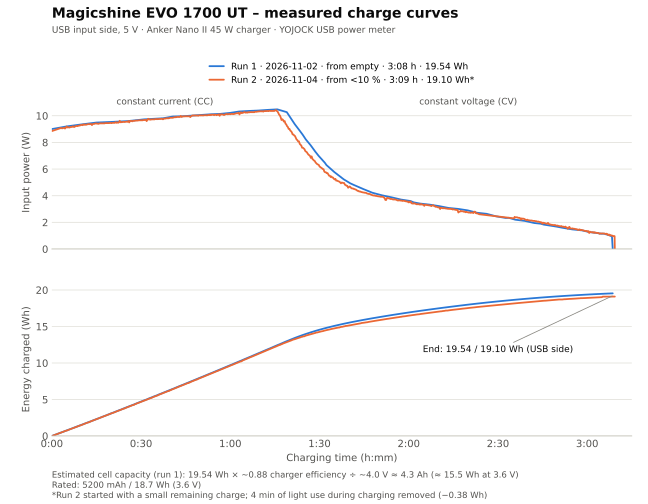

# Magicshine EVO 1700 UT – Bluetooth LE documentation

Open, reverse-engineered documentation of the Bluetooth LE interface of the **Magicshine EVO 1700 UT** front light. It is meant for anyone who wants to control the light from a bike computer, a phone or their own code, and for anyone wondering why the battery always shows "100 %".

All results were measured on one real unit (firmware 1.0.0 / software 1.0.1) in November 2026, using a Mac, an iPhone and a Hammerhead Karoo 3. Statements taken from other projects, the Magicshine manuals or specifications are marked as such.

> **Disclaimer.** This is not an official Magicshine document and is not affiliated with Magicshine. The interface is undocumented and may change with firmware updates. Writing to the light can change its stored modes, and one command (`DF` on the Light Control Point) puts it into firmware-update mode. Use at your own risk.

## Contents

1. [Key findings](#1-key-findings)
2. [Quick start: switching the light via BLE](#2-quick-start-switching-the-light-via-ble)
3. [Device and firmware](#3-device-and-firmware)
4. [GATT database](#4-gatt-database)
5. [Recommended control path: Xingzhe Light Profile](#5-recommended-control-path-xingzhe-light-profile)
6. [Magicshine protocol (`FFE1` / `FFE0`)](#6-magicshine-protocol-ffe1--ffe0)
7. [Custom modes and the official app](#7-custom-modes-and-the-official-app)
8. [Battery and runtime](#8-battery-and-runtime)
9. [Physical controls](#9-physical-controls)
10. [MJ-6558 remote ("FTR LightSync")](#10-mj-6558-remote-ftr-lightsync)
11. [Connections, ANT+ and bike computers](#11-connections-ant-and-bike-computers)
12. [Notes for developers](#12-notes-for-developers)
13. [Do-not-send list](#13-do-not-send-list)
14. [Corrected assumptions](#14-corrected-assumptions)
15. [Appendix: how to inspect the light with an iPhone and a Mac](#15-appendix-how-to-inspect-the-light-with-an-iphone-and-a-mac)
16. [Sources and credits](#16-sources-and-credits)

---

## 1. Key findings

1. **Two BLE control paths.** The Magicshine channel (`FFE1`/`FFE0`, command `A2`) only stores *custom modes*. The light also implements the open **Xingzhe "Bluetooth Light Profile"** (`8CE5DD03`). It controls the light directly: **real off/on**, low/high beam, intensity and SOS. Every command is acknowledged within 40–130 ms, and the button modes stay untouched.
2. **Battery is reported in steps only**, matching the button LED: green 100–21 %, red 20–11 %, flashing red 10–1 %. This is why apps and bike computers jump from 100 % to 20 %. In one example discharge at full output in the cold, the "low" step left about 20 minutes and the whole charge lasted about 1 h 40 min instead of the 3 h in the manual. Two measured charges took about 3 h 09 min and suggest a battery capacity of about 4.3 Ah (~15.5 Wh), roughly 83 % of the rated 5200 mAh. Your results may differ.
3. **Custom firmware is practically impossible.** The light uses a Nordic SoC with signed Nordic Secure DFU.
4. **Existing Karoo extensions (as of November 2026) unintentionally change the button modes.** They send `A2 … BB` for every mode change, and also as "off", but never delete. Afterwards the button cycles only one mode.
5. **The official Magicshine app keeps custom modes locally** and writes them back to the light every time it connects.
6. **The MJ-6558 remote ("FTR LightSync") is a BLE advertiser.** Its packets carry no ID, but the light stores the remote's Bluetooth address. Listening to the remote works; emulating it is practically impossible.

---

## 2. Quick start: switching the light via BLE

```
1. Connect to the light (advertised name "M2-B0 EVO1700_UT").
2. Enable indications on 8CE5DD03-0A4D-11E9-AB14-D663BD873D93
   and notifications on 8CE5DD02-0A4D-11E9-AB14-D663BD873D93.
3. Write 00              -> indication 80 00 01   (request control)
4. Write 03 0F / 03 00   -> on / off
   Write 04 00 / 04 01   -> low beam / high beam
   Write 06 <0..100>     -> intensity in %
   Write 03 11           -> SOS
5. Every change (including button presses) arrives on 8CE5DD02:
   2F 00 01 <mode> <beam> <intensity>
```

Never send `DF` to `8CE5DD03`, and never write to the DFU service `FE59`. See [section 13](#13-do-not-send-list).

---

## 3. Device and firmware

| Item | Value |
|---|---|
| Advertised name | `M2-B0 EVO1700_UT` |
| Manufacturer (`2A29`) | `Magicshine` |
| Model (`2A24`) | `EVO1700 UT` |
| Firmware (`2A26`) / Hardware (`2A27`) / Software (`2A28`) | `1.0.0` / `1.0.0` / `1.0.1` |
| ANT+ product info (shown on a Hammerhead Karoo 3) | 5-digit device number (unit-specific), model `522`, software `0.101`, hardware `1` |
| Radio / bootloader | Nordic Semiconductor SoC with Nordic Secure DFU (`FE59`) |
| Firmware state | updated via the official Magicshine app before all measurements |

**Published specifications** (not measured). Sources are the [Magicshine product page](https://magicshine.com/products/evo-1700-ut-bike-light) and the [Magicshine Austria distributor page](https://www.magicshinelights.at/evo-1700-ut). A dash means the page does not give the value.

| Item | Magicshine | Magicshine Austria |
|---|---|---|
| Max. output | 1700 lm | 1700 lm, 10,520 cd |
| Max. throw | 205 m | 205 m |
| Beam | high beam + low beam | cut-off, 40° |
| Max. runtime | 17 h | 14 h |
| Battery | 5200 mAh | Li-ion 3.6 V, 5200 mAh |
| Charging | 3 h at 5 V / 2 A (full charge) | USB-C, 2.5 h at 5 V / 2 A |
| Connectivity | ANT+, FTR LightSync, Shimano Di2 | ANT+, FTR LightSync Control (remote MJ-6558, optional), Di2 |
| Water resistance | IPX6 | IPX6 |
| Body | aluminium alloy + plastic, 175 g | aluminium, 151 g, 42 × 46 × 53 mm |
| Mount | – | magnetic quick-lock, GoPro-style interface, for handlebars 28–35 mm |

The Magicshine page agrees with the printed manual (17 h, 3 h charging, same mode table as in [section 8](#8-battery-and-runtime)). The distributor's runtime, charging time and weight differ. Two measured charges took about 3 h 09 min, and the measured energy suggests a capacity of about 4.3 Ah instead of 5200 mAh, see section 8.

**Custom firmware:** Nordic Secure DFU packages are normally signed with the vendor's key, so a modified image would be rejected over the air. Without opening the light and accessing the hardware there is no way forward. Almost everything one could want is available through the Xingzhe profile anyway.

**The non-UT EVO 1700 is a different design.** It has a different GATT layout, an Alibaba AIS OTA service (`FEB3`/`FED4`–`FED8`) instead of Nordic DFU, and no Xingzhe light service. See [lenne0815/karoo-magicshine-controls](https://github.com/lenne0815/karoo-magicshine-controls). Do not assume results transfer between the two.

---

## 4. GATT database

| Service | Characteristic | Properties | Purpose |
|---|---|---|---|
| `180A` Device Information | `2A29`, `2A24`, `2A25`, `2A27`, `2A26`, `2A28`, `2A23`, `2A2A`, `2A50` | read | Standard. System ID, regulatory data and PnP ID read as zeros |
| `180F` Battery | `2A19` | read, notify | Standard battery level in % |
| `FFE1` Magicshine | `FFE0` | read, write, notify | Magicshine command/response channel ([section 6](#6-magicshine-protocol-ffe1--ffe0)) |
| | `FFE2` | read | unknown, read `01 00 01` |
| | `FFE3` | read, notify | unknown, read `00 64` |
| | `FFE4` | write | unknown, **not tested** |
| | `FFE5` | read, indicate | unknown, empty |
| | `FFE6` | write | unknown, **not tested** |
| | `FFE7` | read, indicate | unknown, read `02 71 00` |
| `ADB425D4-B1C6-11ED-AFA1-0242AC120002` Xingzhe Light Service | `8CE5DD01-0A4D-11E9-AB14-D663BD873D93` | read | Light Features |
| | `8CE5DD02-…` | read, notify | Light Machine Status |
| | `8CE5DD03-…` | write, indicate | **Light Control Point** ([section 5](#5-recommended-control-path-xingzhe-light-profile)) |
| | `8CE5DD04-…` | write, indicate | Light Network (spec: not implemented). **Not tested** |
| `42820001-D3E8-480B-95BB-2A34850D4048` | `42820002`–`42820008` | read | Accessory / pairing data as ASCII strings: `42820002` = the light's ANT+ device number (decimal, matches the number shown on the bike computer); `42820004` = **Bluetooth address of the paired MJ-6558 remote** (12 hex digits, no colons); `42820003`/`42820005` = `000000000000`, probably empty slots for further accessories (e.g. Di2); `42820006`–`08` empty. The `2901` descriptors were not read |
| `FE59` Nordic Secure DFU | `8EC90003-F315-4F60-9FB8-838830DAEA50` | write, indicate | Buttonless DFU. **Never write** |

The advertising contains the Xingzhe light service short UUID `25D4` and service data on `FFE1` (`16 01 00 <x> 02 00 00 64`, meaning unknown). The light keeps advertising while another client is connected, but not while the transport lock is on.

---

## 5. Recommended control path: Xingzhe Light Profile

The service `ADB425D4-…` follows the public **Bluetooth Light Profile** of the bike computer maker Xingzhe (行者): <https://developer.imxingzhe.com/docs/device/light/> (version 1.6.0). It is meant for bike computers to control lights. The official Magicshine app does **not** use it.

This is the only path found that offers a real **off** command without touching the light's stored modes.

### 5.1 Features and status as reported by the UT

`8CE5DD01` Light Features = `02 00 81 80 02 00 0E FF 64 00`. The light returns 10 bytes; the spec defines 20, and the Basic Functions field is missing.

| Field | Raw | Meaning (per spec) |
|---|---|---|
| Light Type (u16) | `0x0002` | front light |
| Light Mode (u32) | `0x00028081` | bit 0 off, bit 7 fast flash, bit 15 steady on, bit 17 SOS |
| Beam (u8) | `0x0E` | low/high beam supported, 3 modes |
| Focus | `0xFF` | not supported |
| Intensity | `0x64` | adjustable up to 100 % |
| Color | `0x00` | single colour |

`8CE5DD02` Light Machine Status, e.g. `2F 00 01 0F 00 19`:

| Byte | Field | Example | Meaning |
|---|---|---|---|
| 0 | Flags | `2F` | fields present: index, type, mode, beam, intensity |
| 1 | Light Index | `00` | |
| 2 | Light Type | `01` | front light |
| 3 | Light Mode | `0F` | `00` off, `0F` steady on, `11` SOS |
| 4 | Beam Mode | `00` | `00` low beam, `01` high beam |
| 5 | Intensity | `19` | current intensity in % of the active beam's maximum (`FF` until it first changes) |

The status is sent as a notification after every change.

### 5.2 Control Point commands (`8CE5DD03`, write with response)

Each command is `<opcode> [parameter]`. The light answers with an indication `80 <opcode> <result>`, where `01` = success. The spec also defines `02` not supported, `03` invalid parameter, `04` failed and `05` not permitted.

| Command | Effect on the UT | Measured |
|---|---|---|
| `00` | Request Control. Send once after connecting, before any other command | ✅ `80 00 01` |
| `03 00` | **Light off** (fully dark) | ✅ |
| `03 0F` | Light on (steady) with the last intensity | ✅ |
| `03 11` | SOS | ✅ |
| `03 07` | Fast flash. **No effect, no indication**, although listed in Features | ❌ |
| `04 00` / `04 01` | Low beam / high beam | ✅ |
| `06 <0–100>` | Intensity in %. Tested with 10, 25 and 50 % on the low beam | ✅ |
| `01` | Reset of device control. Scope unclear, **not tested** | – |
| `DF` | **Enters DFU mode and disconnects. Never send** | – |

### 5.3 Full opcode list (from the spec) and UT status

Functions `10`–`1A` accept `FF` (or `FFFF`/`FFFFFFFF`) as "read current value". **On the UT, none of these queries got any answer**, neither with the light off nor on. They are silently ignored instead of returning "not supported" (`02`). The same happens with `03 07`. This matches the missing Basic Functions field.

| Op | Meaning | Parameter | UT |
|---|---|---|---|
| `00` | Request Control | – | ✅ works |
| `03` | Set light mode | u8 | ✅ `00`, `0F`, `11`; `07` no response |
| `04` | Beam low/high | `00`/`01` | ✅ works |
| `06` | Intensity | 0–100 | ✅ works |
| `10` | Auto-sleep | `00`/`01`/`FF` | ❌ no response |
| `11` | Wake on motion | `00`/`01`/`FF` | ❌ no response |
| `12` | Auto-sleep time | u16 30–6000 s / `FFFF` | ❌ no response |
| `13` | Brake detection | `00`/`01`/`FF` | ❌ no response |
| `14` | Brake light intensity | 0–100 / `FF…` | ❌ no response |
| `15` | Ambient light sensor | `00`/`01`/`FF` | ❌ no response |
| `16`–`18` | Team animation / navigation sync / data sync | `00`/`01`/`FF` | ❌ no response |
| `19` / `1A` | Animation ID / team animation ID | u32 / `FFFFFFFF` | ❌ no response |
| `24` | Paired remote (`FFFFFFFF` = query) | u32 | ❌ no response |
| `DF` | Enter DFU | – | **never send** |

Not tested (see the spec): `01` reset, `02` light type, `05` focus, `07` intensity mode, `08` fall detection, `09` colour, `0A`/`0B` training and navigation data, `DA` date and time.

### 5.4 Measured behaviour

- **Latency:** The indication arrives 40–130 ms after the write.
- **Button modes stay untouched.** This path never creates custom modes.
- **Disconnect keeps state.** After `03 00` and a disconnect, the light stays off. It advertises again and accepts a new connection within about 1 s. A new `00` plus `03 0F` switches it back on with the last intensity.
- **Button presses are reported, but only after `00`.** Subscribing to `8CE5DD02` alone delivers no notifications. After `00`, every press on the light's button or the remote produces a `8CE5DD02` notification with mode, beam and intensity, also for custom modes. Flash modes are **not** reported. A double click passes through intermediate values before the beam changes. Nothing is sent unsolicited on `FFE0`.
- The status read right after connecting reflects the real state: `2F 00 01 00 00 FF` = off, `2F 00 01 0F 00 FF` = on.
- `03 00` / `03 0F` also act while a custom mode is active. `03 0F` then returns with the custom mode's intensity.
- **No release command.** The spec has none; disconnecting was enough in all tests.

---

## 6. Magicshine protocol (`FFE1` / `FFE0`)

Used by the official Magicshine app and by existing community projects.

### 6.1 Framing

```
DE <len> <cmd> <data …> <xor> ED
```

- `len` = total frame length including `DE` and `ED`.
- `xor` = XOR of all bytes from `len` up to the last data byte.
- Commands are written to `FFE0`; responses arrive as notifications on `FFE0`. The response command is the request command + `0x10` (e.g. `A4` → `B4`).

### 6.2 Queries (read-only)

| Request | Response (UT) | Meaning |
|---|---|---|
| `DE06A400A2ED` (A4) | `DE13B40004000000640000000000000000C7ED` | battery step: data byte 4 (frame byte 8) = `0x64` = 100 |
| `DE06A100A7ED` (A1) | `DE0DB100001118071B0103ABED` | info; **temperature in °C = data byte 4 (frame byte 8)**, here 27 °C |
| `DE06AD00ABED` (AD) | `…45564F313730305F5554…` | model name, ASCII `EVO1700_UT` |
| `DE06AB00ADED` (AB) | `DE08BB0000FF4CED` | speed sensor, meaning unknown |
| `DE06AC00AAED` (AC) | `DE08BC0000FF4BED` | light sensor, meaning unknown |
| `DE06A500A3ED` (A5) | none | profiles; no answer on the UT |
| `DE06A900AFED` (A9) | none | runtime; no answer on the UT |
| `DE07A601EF4FED` (A6 01) | not observed | sent by the official app after connecting; meaning unknown, **not tested** |

The official app polls `A1` and `A4` every 20 s. Projects written for other lamps locate the temperature by searching for the byte pattern `17 03`. That pattern does not occur on the UT; use the fixed position instead.

### 6.2.1 Response byte layout (decoded from the firmware)

The app firmware (`com.zhongben.magicshine` 1.2.6, decompiled) was used to decode the response payloads. Data bytes are counted from `0` (the byte after the `status` byte, i.e. frame byte 4).

**`B4` – battery.** The payload carries the **cell voltage**, not just the coarse step:

| Data byte | Field | Example (`…04000000640000…`) |
|---|---|---|
| 0 | cell voltage, whole volts | `04` = 4 V |
| 1 | cell voltage, tenths | `00` → 4.0 V |
| 2–3 | always `00` | |
| 4 | coarse charge step % (100 / 20 / 10 / 0) | `64` = 100 |
| 5–12 | always `00` | |

The firmware computes the voltage as `(ADC × 3600/4095) × 2`, i.e. a single Li-ion cell read through a 2:1 divider, rounded to 0.1 V. Byte 1 is a real tenths digit: six reads in a row gave 4.0 V and 4.1 V (`…0400…` and `…0401…`), so it is not fixed. **A client can therefore ignore byte 4 and compute its own fine percentage from bytes 0–1 with a proper discharge curve** — this is the only way to get a smooth gauge without new firmware. Limits: 0.1 V resolution and load-dependent sag, so smooth the value.

**`B1` – info.**

| Data byte | Field | Example (`…001118071B0103`) |
|---|---|---|
| 0–3 | fixed constant `00 11 18 07` | never changes; probably a version/signature |
| 4 | temperature in °C | `1B` = 27 °C |
| 5 | temperature sign (`01` = ≥ 0 °C, `00` = below) | `01` |
| 6 | fixed constant `03` | |

**`AB` → `BB` and `AC` → `BC`.** In the firmware the payload is the fixed constant `00 FF` (`local_78 = 0xff00`); there is no sensor read behind it. These commands return no real data on the UT, so the "speed sensor" / "light sensor" labels carry nothing usable.

### 6.3 `A2` – custom modes (not live control)

```
DE 14 A2 01 <slot> <G0: on, pattern, value> <G1: on, pattern, value> 00 00 00 00 00 00 <op> <xor> ED
```

| Field | Values |
|---|---|
| `slot` | custom-mode slot, starting at `01` |
| G0 | low beam: `on` = `01`/`00`, `pattern` = `01` steady, `02` SOS, `03` flash, `value` = intensity in % |
| G1 | high beam, same layout |
| `op` | `BB` = add/overwrite custom mode, `AA` = delete custom mode. `00` is **ignored** (no ack, no effect) |

Ack: `DE 07 B6 00 <r> <xor> ED`.

**What `BB` really does:** It does **not** set the light "live". It stores a custom mode, and the light switches to it immediately. From then on, the button cycles only through the custom modes of that beam instead of its three factory levels. Deleting it with `AA` brings the factory levels back.

Examples (as sent by the official app):

| Purpose | Frame |
|---|---|
| Low beam 10 % | `DE14A2010101010A000000000000000000BB07ED` |
| Low beam 50 % | `DE14A20101010132000000000000000000BB3FED` |
| High beam 24 % | `DE14A20101000118010118000000000000BB0CED` |
| Low beam SOS 24 % | `DE14A20101010218000118000000000000BB0FED` |
| Delete slot 1 | `DE14A20101010118000000000000000000AA04ED` |

---

## 7. Custom modes and the official app

### 7.1 Slot rules (measured)

- **Slot = position in one shared list of custom modes**, not the beam choice. The beam is defined only by which group is `on` in the frame.
- **Capacity:** slots 1–6 were all accepted, and the button cycles them in slot order. More were not tried.
- **Low and high beam share the list.** Writing a high-beam mode to a slot that held a low-beam mode replaces it.
- **Slots shift down on delete.** After deleting slot 1 of six, the former slot 2 is slot 1 and slot 6 is empty.
- **`AA` deletes by slot.** The rest of the frame is ignored.
- `BB` on a slot beyond the end of the list is rejected (`r = 00`, no effect). Appending to the next free slot works.
- When the active custom mode is deleted, the light jumps to the next remaining mode, or back to the factory level when none is left.
- Ack `r`: `01` = applied. `00` comes for empty or out-of-range slots, but twice a delete with `r = 00` did take effect. So `r = 00` does not reliably mean "failed".
- Custom modes survive power cycles.

**Safe clean-up:** repeat `AA` on slot `01` (any content) until the ack is `r = 00` (`DE07B60000B1ED`). Then the list is empty and both beams are back to their factory levels.

**Reading custom modes:** There is no list query (`A5` gets no answer). To see the stored modes, subscribe to `8CE5DD02`, send `00` and cycle through the modes with the button. Each press reports the active mode's pattern, beam and intensity.

**"Off" written as `A2`:** `BB` with intensity 0 (`DE14A20101010100000000000000000000BB0DED`) does not switch the light off. It stores a custom mode that the light runs at its minimum (status intensity `01`). Existing Karoo extensions (as of November 2026) use exactly this frame as "off", for example whenever their settings screen is opened or after a mode preview. The result is a single, very dim low-beam level on the button.

### 7.2 How the official Magicshine app handles custom modes (iPhone capture)

- **It keeps custom modes locally and never reads them from the light.** Modes written by another client do not appear in the app. It only reads `FFE0` (which holds just the last frame) and `2A19`.
- **When it connects, it writes all stored custom modes back** (`BB` on slot 1, 2, … in order, about 60 ms apart). A mode deleted by another client therefore comes back. To remove a custom mode for good, delete it in the app.
- It assigns slots in creation order and enables exactly one group per mode. The UI offers one custom mode per beam; the light supports more. Its slider sends values about 1 % below the displayed value.
- Moving the slider sends a `BB` preview. **"Save" sends nothing.**
- Back without saving: an existing mode is restored with `BB`; a newly started mode is deleted with `AA`.
- Delete (swipe left, bin): `AA` on the entry's slot, then the remaining modes are rewritten to their shifted slots.
- **While the app is open, it holds a permanent connection**, also on the overview screen and the light's settings screen, and polls `A1`/`A4` every 20 s. "Pull to refresh" sends nothing over BLE. In the background the connection stays up but polling stops; closing the app disconnects. Other clients can connect at the same time ([section 11](#11-connections-ant-and-bike-computers)).
- The app's "Light Sensor" and "Motion Detection" switches are greyed out for the UT; it apparently has no ambient light sensor.

---

## 8. Battery and runtime

**Battery indicator** (manual, confirmed by observation):

| Indicator | Meaning |
|---|---|
| steady green | 100–21 % (while charging: full) |
| steady red | 20–11 % |
| flashing red | 10–1 % (while charging: charging) |

- The light reports only these steps *as a percentage*; app and ANT+ bike computers show 100 % for most of a ride and then about 20 %. But the `B4` response also carries the raw cell voltage (0.1 V resolution) in data bytes 0–1 — see [section 6.2.1](#621-response-byte-layout-decoded-from-the-firmware). A client can build a much finer gauge from that voltage instead of the step.
- `A4` and the standard `2A19` both read 100 on a full battery.
- **Below 10 %, the light switches itself to a very low output** and the button LED flashes red. The manual says the level cannot be changed then. In the single discharge recorded for this document, full output could still be selected by hand, but the light then shut down after about 4 minutes. Whether BLE commands still work in this state was not measured.
- Charging takes about 3 h at 5 V / 2 A according to the manual and the Magicshine product page (the Austrian distributor states 2.5 h). The battery is specified as 3.6 V / 5200 mAh (about 18.7 Wh). The printed manual of the tested unit does not list the capacity. Two measured charges suggest about 4.3 Ah (~15.5 Wh), see the example charges below.
- **While charging**, BLE and the remote keep working, and the light can be switched on. The status shows the normal off/on mode; the spec's "charging" mode (`17`, decimal 23) was not reported.
- On the non-UT EVO 1700, lenne0815 measured a full discharge in which `B4` only reported 100 → 50 → 30.

**Example discharge** (one recording by the tester, one unit, high beam HIGH, 1700 lm, outdoors at 3–4 °C ambient, starting at the 100 % step):

| Elapsed | Reported step | Behaviour |
|---|---|---|
| 0–74 min | app 100 % (step 100–21 %) | full output |
| 74 min | app 20 %, bike computer "low" (step 20–11 %) | full output continues |
| 93 min | bike computer "critical" (step 10–1 %) | light drops to a very low output by itself, LED flashes red |
| 94–98 min | critical | full output selected by hand, light shuts down after about 4 min |

- In this recording, the runtime at full output was about 1 h 40 min, well below the 3 h in the manual (measured at 25 °C with airflow). About 20 minutes of full output remained after the change to "low".
- These figures come from a single unit under these specific conditions. Runtimes depend on temperature, airflow, battery age and charge level, and other lights may behave differently. Treat the table as an example, not as a specification.

**Example charges** (two recordings by the tester, same unit, 45 W USB-C charger, measured with a USB power meter on the input side). The meter display was filmed as an iPhone time-lapse and read frame by frame. Run 2 has one data point every 16 s (read by OCR, checked against power = voltage × current), run 1 one point about every 3 min (blurry video, read by hand).



| | Run 1 (2026-11-02) | Run 2 (2026-11-04) |
|---|---|---|
| Start | empty, after the light had shut itself off | below 10 % (flashing red), not fully empty |
| Charging time until the charger stops | 3:08:35 h | 3:09:17 h |
| Energy drawn from USB | 19.54 Wh (3780 mAh at ~5.17 V) | 19.48 Wh (3769 mAh); **19.10 Wh** after removing 4 min of light use during charging |
| Input power at start | ~9.0 W | ~8.9 W |
| Peak input power (end of constant current) | 10.48 W (2.02 A) | 10.42 W (2.01 A) |
| Switch to constant voltage | ~1:16–1:19 h, at ~12.4–13.0 Wh | 1:15 h, at 12.3 Wh |
| Charger stops at | ~0.18 A (~0.9 W) | ~0.19 A (~1.0 W) |

| Elapsed | Run 1: input power / energy | Run 2: input power / energy |
|---|---|---|
| 0:00 | 9.0 W / 0 Wh | 8.8 W / 0 Wh |
| 0:30 | 9.7 W / 4.7 Wh | 9.7 W / 4.7 Wh |
| 1:00 | 10.2 W / 9.7 Wh | 10.1 W / 9.6 Wh |
| 1:30 | 6.9 W / 14.6 Wh | 6.2 W / 14.3 Wh |
| 2:00 | 3.6 W / 16.9 Wh | 3.5 W / 16.5 Wh |
| 2:30 | 2.4 W / 18.4 Wh | 2.4 W / 17.9 Wh |
| 3:00 | 1.3 W / 19.4 Wh | 1.3 W / 18.9 Wh |
| end | 0 W / 19.54 Wh | 0 W / 19.10 Wh |

- **Charging profile:** constant current for the first ~1 h 15 min, with the input power rising from ~9 to ~10.5 W as the cell voltage rises. Then constant voltage: the power tapers off for almost 2 hours, and about a third of the energy goes in during this phase. The total of about 3 h 09 min matches the manual's 3 h.
- **Run 2 correction:** the light was switched on for 4 minutes at 2:24–2:28 h while charging (input jumped to ~1.4 A / 7.4 W), followed by a few minutes of extra recharging. For this period the input power was replaced by a straight line between the last undisturbed value before and the first value back on the constant-voltage trend. The difference of 0.38 Wh was subtracted from all later energy values.
- **Consistency:** run 2 needed 0.44 Wh (about 2 %) less than run 1, which fits its small remaining charge. Its slightly earlier switch to constant voltage points the same way.
- **Estimated battery capacity:** the figures are measured at the USB input and include charging losses. Assuming a charger efficiency of about 0.88 (0.85–0.92) and a mean cell voltage of about 4.0 V while charging, run 1 gives 19.54 Wh × 0.88 ÷ 4.0 V ≈ **4.3 Ah (range 4.1–4.5 Ah), about 15.5 Wh at 3.6 V**. That is roughly **83 % (80–87 %) of the rated 5200 mAh / 18.7 Wh**, or about 2150 mAh per 18500 cell. A rated 18.7 Wh would require a charging efficiency of about 96 %, which is unusually high.
- With ~15.5 Wh, the example discharge above corresponds to an average of about 9.5 W at full output.
- The recordings contain no BLE values, so they do not show how `A4` or `2A19` change during charging. The same caveats as for the discharge apply: one unit, one charger, room temperature.
- Raw and corrected data points (773 rows, with the origin of every value) are in [`charging/charge-curves.csv`](charging/charge-curves.csv); [`charging/plot_charge_curves.py`](charging/plot_charge_curves.py) recreates the chart (Python 3, matplotlib).

**Output and runtime** (manual and Magicshine product page, which agree; manual conditions: ANSI FL1, 25 °C, 25 km/h airflow):

| Beam | Level | Lumen | Runtime | BLE status intensity |
|---|---|---|---|---|
| Low | LOW | 200 | 17 h | 25 % |
| Low | MEDIUM | 400 | 9 h | 50 % |
| Low | HIGH | 800 | 5 h | 100 % |
| High | LOW | 400 | 10 h | 25 % |
| High | MEDIUM | 800 | 5 h | 50 % |
| High | HIGH | 1700 | 3 h | 100 % |
| Flash | Day Flash | 0–1700 | 10.5 h | – |
| Flash | Night Flash | 400–1700 | 6 h | – |

These runtimes allow a software estimate of the remaining runtime. The manual does not mention SOS, although the light supports it via BLE.

**Other behaviour** (observed): no auto-off. No StVZO marking on the tested unit.

---

## 9. Physical controls

**Light button:**

| Gesture | State | Effect |
|---|---|---|
| hold 1 s | on / off | switch on / off; it switches on in the last used mode |
| click | on | next level LOW → MEDIUM → HIGH |
| double click | on | low beam ↔ high beam |
| click | off | show battery level for 3 s |
| hold 3 s | off | transport lock on; unlock by holding 3 s or connecting the charger. **While locked, the light is radio-silent**: no advertising, no BLE connection, remote ignored |
| click, then hold 3 s | off | clear pairing memory (remote / Di2) per manual; other Magicshine manuals say 10 s, not verified on the UT |

**MJ-6558 remote**, measured via the `8CE5DD02` status with factory modes:

| Gesture | Effect |
|---|---|
| ○ click | next level of the current beam: 25 → 50 → 100 → 25 % |
| ○ double click | low beam ↔ high beam; the new beam starts at 25 %. In high beam, ○ click then cycles the high-beam levels |
| □ click | **high beam 100 % ("full output")** from any low-beam level; the next ○ or □ click returns to the previous low-beam level |
| □ double click | flash mode; a second □ double click flashes faster (probably Day/Night Flash); ○ click ends it. No status notification |
| ○ or □ hold 1 s | on / off (with a paired FTR tail light: both), per manual |
| any button hold 5 s | lock / unlock the remote (3 s red / green), per manual |

**Pairing the remote (leaflet):** Switch the light on. Hold ○ and □ for about 5 s until the remote flashes blue. Hold the remote close to the light button until the light flashes blue as well, then click ○ or □. Both indicators show blue for 2 s.

**Shimano Di2 (manual):** Clear an existing remote pairing first; remote and Di2 appear to share one pairing. Wake Di2 with a button press and switch the light on; it searches (flashing blue). Success = 3 s steady blue; it gives up after 5 min. At least two free Di2 buttons are needed.

---

## 10. MJ-6558 remote ("FTR LightSync")

"FTR LightSync" (**F**ront light, **T**ail light, **R**emote) is plain **BLE advertising**. The remote (advertised name `M0-C0 MJ_6558`) does not connect. Each button event is a burst of about 3–17 advertisements with service data on UUID `FFE1`; nothing is sent between presses.

```
18 01 06 <counter> 02 02 <code>
```

| Byte | Meaning |
|---|---|
| 0–2 | `18 01 06`, constant |
| 3 | event counter, +1 per event, wraps around |
| 4–5 | `02 02`, constant |
| 6 | button code |

| Code | Button ○ | Button □ |
|---|---|---|
| short | `21` | `11` |
| double | `22` | `12` |
| long (> 1 s) | `23` | `13` |
| press start (just before a code) | `00` | `00` |

- **The payload contains no device ID.** The light stores the paired remote's Bluetooth address in characteristic `42820004` and very probably filters packets by it.
- **Emulation from macOS fails.** Passing the undocumented key `"kCBAdvDataServiceData"` to `CBPeripheralManager.startAdvertising` reports success, but an iPhone scanning nearby never received any `FFE1` service data from the Mac. A `CBUUID` key crashes.
- **Emulation from Android** is possible for the payload, but Android cannot normally use a foreign, fixed Bluetooth address. Because of the address filter, this is unlikely to work.
- **Listening works.** A bike computer extension can use the remote's buttons as an extra input.
- The remote itself exposes a GATT server with `FFE1` (`FFE0`–`FFE7`) and the Alibaba AIS OTA service `FEB3`. Readable values were empty or zero, and reading did not affect pairing.

---

## 11. Connections, ANT+ and bike computers

- **The light accepts at least two simultaneous BLE connections.** Confirmed with an HCI capture on the iPhone: the Magicshine app stayed connected for almost 5 minutes without interruption, while a Mac connected seven times in between and read characteristics; the light answered both. Connecting as a second client took 7–10 s instead of about 5 s.
- **The remote keeps working while a client is connected.** In a systematic test, every remote action worked with no client, with a Mac connected (with and without `00`) and with the Magicshine app connected: level changes, full beam, off, and on again after up to about 3 minutes off. This also holds when the connection was established while the light was off.
- ANT+ is independent of BLE and of the remote/Di2 pairing. The light supports the ANT+ Lighting Control profile.
- **Re-pairing via ANT+ on a Karoo does not touch the custom-mode list.**
- With the Karoo's **"Auto Control"** on, the Karoo switches the light itself via ANT+. It did so right after pairing, going to 50 % and then off.

---

## 12. Notes for developers

1. **Control the light via `8CE5DD03`** (Xingzhe), not via `A2`.
2. **Never send `A2 … BB` without a matching delete**, and never use it as "off".
3. **Subscribe to `8CE5DD02` and send `00`.** The status then reports every change, including button presses on the light and the remote. Without `00`, no notifications arrive. Flash modes are not reported.
4. **Holding the connection is fine.** The remote and the light's button keep working while a client is connected, also if the connection was made while the light was off.
5. **Turn off "Auto Control" on the bike computer** when controlling via BLE.
6. **Show the battery as a step** (high / low / critical), not as a fake percentage. Estimate the remaining runtime from the time spent per level, and do not rely on the official runtimes in the cold (see the example in [section 8](#8-battery-and-runtime)). Treat the change to "low" as a warning that the remaining time at full output may be short.
7. **Repair a light with stray custom modes** with the clean-up recipe in [section 7.1](#71-slot-rules-measured), or by deleting the entries in the Magicshine app.
8. **Treat a locked light as "not reachable".** With the transport lock on, the light neither advertises nor accepts connections.

---

## 13. Do-not-send list

| Target | Reason |
|---|---|
| `FE59` / `8EC90003` | Nordic DFU |
| `8CE5DD03` opcode `DF` | enters DFU mode |
| `8CE5DD03` opcodes `01`, `02`, `05`, `07`–`0B`, `24` (with an ID), `DA` | untested; `02` changes the light type |
| `8CE5DD04` | untested |
| `FFE4`, `FFE6`, service `42820001` | unknown purpose |
| `A2 … BB` without a matching `AA` | changes the button modes |

---

## 14. Corrected assumptions

These came up during the investigation and turned out to be wrong or incomplete:

- **"`A2` with `00` instead of `BB` sets the light only temporarily."** This was observed on an EVO 1300, but the UT simply ignores such frames.
- **"The slot byte selects low or high beam."** Wrong. It is a slot number; the beam comes from the frame content.
- **"`AA` restores the factory modes of the affected beam."** Imprecise. `AA` deletes one slot, and the others shift down.
- **"The light accepts only one connection and stops advertising while connected."** Wrong. An HCI capture showed two simultaneous connections and continued advertising. Gaps in the advertising appeared only while the Mac itself was connected; whether the light or macOS caused them is unclear.

---

## 15. Appendix: how to inspect the light with an iPhone and a Mac

No programming is needed for these steps.

### 15.1 Preparation

- Close the Magicshine app. Otherwise it writes its stored custom modes back to the light when it connects and adds its own traffic to the capture.
- Disable bike computer extensions that connect to the light via BLE.
- Turn off other Bluetooth devices on the iPhone (headphones, watch) to keep captures small.

### 15.2 List the light's services

1. Install **nRF Connect for Mobile** (Nordic Semiconductor) or **LightBlue** (Punch Through) on the iPhone, or **LightBlue** / **Bluetility** on the Mac.
2. Scan, select `M2-B0 EVO1700_UT` and connect.
3. Expand all services and note their UUIDs. Read **Device Information** (`180A`) for manufacturer, model and firmware.
4. **Only read, never write.** Then disconnect.

Apple shows its own device identifier instead of the Bluetooth address. This is normal.

### 15.3 Capture the official Magicshine app

**One-time setup:**
1. Sign in at <https://developer.apple.com/bug-reporting/profiles-and-logs/> with a free Apple ID and download the **Bluetooth** profile for iOS. Install it on the iPhone (*Settings → General → VPN & Device Management*) and restart the iPhone if asked. The profile expires after a few days.
2. Download **Additional Tools for Xcode** from <https://developer.apple.com/download/all/>. The DMG contains **PacketLogger** in the *Hardware* folder.

**Capture:**
1. Connect the iPhone to the Mac by cable, unlock it and confirm "Trust".
2. In PacketLogger choose **File → New iOS Trace**. The iPhone's Bluetooth traffic is now recorded live.
3. Use the Magicshine app slowly, one action at a time, with a few seconds' pause in between, and note the time of each action. Examples: change level, switch beam, start a flash mode, create, change and delete a custom mode.
4. Save the trace as `.pklg`.
5. Wireshark opens `.pklg` files directly. Useful filters:
   - `btatt`: all ATT traffic
   - `btatt.opcode == 0x12 || btatt.opcode == 0x52`: writes from the app
   - `btatt.opcode == 0x1b`: notifications from the light

The trace contains **all** Bluetooth traffic of the iPhone, including other devices nearby. Do not publish raw traces.

---

## 16. Sources and credits

- [lenne0815/karoo-magicshine-controls](https://github.com/lenne0815/karoo-magicshine-controls): EVO 1700 (non-UT) captures and discharge test
- [TimFourcode/evo1300](https://github.com/TimFourcode/evo1300): first use of `8CE5DD03` (HORI 1300), observation on the save flag
- [m4jki/allty-1500s-control](https://github.com/m4jki/allty-1500s-control): `A2` as custom-mode add/delete with slots
- [JaJaJim/KMagicWheeltopBlip](https://github.com/JaJaJim/KMagicWheeltopBlip): MJ-6558 advertising format
- [derstrassi/karoofirefly](https://github.com/derstrassi/karoofirefly), [JaJaJim/LightONKaroo](https://github.com/JaJaJim/LightONKaroo): Karoo integration and original Magicshine frames
- Xingzhe Bluetooth Light Profile: <https://developer.imxingzhe.com/docs/device/light/> (© Shanghai Da Bu Zi Duo Information Technology Co.; only the parts needed here are summarised)
- Magicshine: EVO 1700 UT user manual, MJ-6558 leaflet and FAQ (facts summarised, not reproduced)
- Magicshine product page for the EVO 1700 UT: <https://magicshine.com/products/evo-1700-ut-bike-light> (specifications, mode and runtime table)
- Magicshine Austria distributor page: <https://www.magicshinelights.at/evo-1700-ut> (specifications)
- Tools: [bleak](https://github.com/hbldh/bleak) (Python BLE library), Apple PacketLogger, Wireshark, [Tesseract](https://github.com/tesseract-ocr/tesseract) (reading the charge recordings), matplotlib
